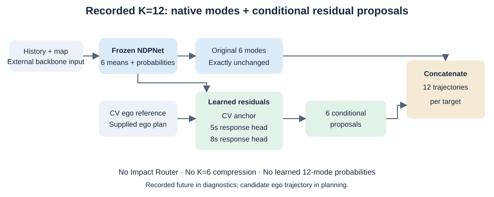

# Ego-conditioned Behavior Prediction

## New: Direct D (v0.2.0)

The fully trained **Direct D** checkpoint is available in [`checkpoints/direct_d`](checkpoints/direct_d). It adds six **direct** ego-conditioned proposals to six unchanged frozen NDPNet modes at **10 Hz**, without a CV reference or residual trajectory addition. This is a separate model from legacy Recorded K=12 below.

- [Model card, input/output contract and final evaluation](docs/DIRECT_D_MODEL_CARD.md)
- [Architecture and training objective](docs/INTERACTION_K12.md)
- Run `python examples/direct_d_demo.py`; load weights with `from interaction_k12 import load_direct_d`.
- No learned probabilities for the six new proposals; no NDPNet weights or dataset caches are included.

## Legacy Recorded K=12 (v0.1.0)

Recorded K=12 augments a **frozen NDPNet** with six ego-plan-conditioned trajectory proposals. It keeps the six original trajectories unchanged and returns a 12-trajectory pool for each prediction target.

**This release has no impact router, no hard bypass for unaffected agents, and no learned probabilities for the 12-mode pool.** It is a research model for trajectory coverage and conditional prediction diagnostics, not a calibrated joint distribution or a production driving system.

## What is included

- Portable PyTorch inference at 2 Hz, plus a 10 Hz residual interpolation interface.
- The locked anchor, 5-second response and 8-second response checkpoints, with SHA-256 verification.
- A synthetic example, cache-based training and evaluation scripts, and correctness tests.
- Architecture equations, data-format contracts, training provenance, evaluation results, and planning integration notes.
- Historical implementation snapshots for traceability.

NDPNet backbone weights, raw WOMD/nuPlan datasets, per-scene caches and simulator dependencies are **not** included. Obtain these from their official sources under their respective terms.

## Quick start

Python 3.10+ and PyTorch 2.2+ are required. CPU inference is supported; CUDA is optional.

```bash
python -m pip install -e .
python examples/synthetic_demo.py
python -m unittest discover -s tests -v
```

The example uses synthetic inputs only. It checks execution, not prediction quality.

```python
import torch
from recorded_k12 import RecordedK12

model = RecordedK12("checkpoints/locked").eval()
with torch.inference_mode():
    pool = model(native, probabilities, object_type, ego_cv, ego_plan)
# native: [N, 6, 16, 2]; pool: [N, 12, 16, 2]
# pool[:, :6] is exactly native.
```

Inputs must be in each target agent's local coordinate frame, with future timestamps 0.5, 1.0, ..., 8.0 seconds. `ego_plan` is the supplied ego future, **not the target agent's future**. See [data format](docs/DATA_FORMAT.md).

## Architecture



For target agent i, let X denote the six frozen trajectories and q their probabilities.
The feature builder forms a context from X, q, object type and the CV ego reference.
An anchor head produces six residual trajectories. Separate response heads modify these proposals using differences between the supplied ego plan and the CV reference in interaction-geometry feature space.

The output contains **six frozen modes + six residual proposals**. All eligible targets receive proposals. Preserving the original modes preserves their oracle coverage; it does not guarantee preservation of probability-weighted accuracy or of a downstream planner's decisions.

See [model details and equations](docs/MODEL.md), [model card](docs/MODEL_CARD.md), and [Flow Planner integration](docs/PLANNING.md).

## Results of the locked model

These are **conditional diagnostics on WOMD validation**, using recorded ego future. They are not official hidden-test submissions. Errors are meters; lower is better. K differs between frozen and augmented arms.

### Classic validation: matched vehicle slice

5,209 scenarios; 14,014 eligible vehicle targets (endpoint-valid counts vary by horizon).

| Model | K | 5s minADE | 5s minFDE | 8s minADE | 8s minFDE |
|---|---:|---:|---:|---:|---:|
| Frozen NDPNet | 6 | 0.52809 | 0.97500 | 1.07035 | 2.08582 |
| CV K=12 | 12 | 0.46479 | 0.79252 | 1.02010 | 1.73795 |
| Recorded K=12 | 12 | 0.46462 | 0.79200 | 1.01968 | 1.73544 |

### Interaction validation: pair-conditioned diagnostic

40,341 pairs, predicting one target conditioned on the other agent's future. Class-macro average over vehicle, pedestrian and cyclist; valid masks determine metric-specific counts. These are conditional marginals, not official joint pair modes.

| Model | K | 5s minADE | 5s minFDE | 8s minADE | 8s minFDE |
|---|---:|---:|---:|---:|---:|
| Frozen NDPNet | 6 | 0.48587 | 0.95676 | 0.95045 | 1.94082 |
| CV K=12 | 12 | 0.43416 | 0.81893 | 0.91356 | 1.68645 |
| Recorded K=12 | 12 | 0.43373 | 0.81769 | 0.91250 | 1.68376 |

**Interpretation:** much of the improvement over frozen NDPNet is already obtained by the CV pool. The additional recorded-plan benefit is small and must not be attributed to a proven causal reaction model. The classic slice and interaction macro average have different populations and cannot be directly compared as benchmark difficulty. See [evaluation protocol](docs/EVALUATION.md) and machine-readable [results](results/).

## Train or evaluate your own prepared caches

```bash
python scripts/train_cache.py --train data/train.npz --val data/val.npz \
    --output outputs/new_model --device cuda:0
python scripts/evaluate_npz.py data/eval.npz \
    --checkpoints checkpoints/locked --device cuda:0 --output outputs/metrics.json
```

Training updates only the three residual heads. The external frozen NDPNet generates cached predictions beforehand. Training and validation must have disjoint original scene identifiers. The published checkpoints are the historical locked fold-0 artifacts, not newly trained weights. See [training and reproduction](docs/TRAINING.md).

## Dependencies and attribution

- [NDPNet](https://github.com/HuaHu-yizhou/NDPNet): external frozen backbone and its official checkpoint instructions.
- [Waymo Open Dataset](https://github.com/waymo-research/waymo-open-dataset): native scenario data and official metrics tooling.
- [InterHub](https://github.com/zxc-tju/InterHub): event selection used in the research pipeline.
- [Flow Planner](https://github.com/DiffusionAD/Flow-Planner): optional downstream ego candidate generator.
- [nuPlan devkit](https://github.com/motional/nuplan-devkit) and [InterPlan](https://github.com/mh0797/interPlan): optional planning evaluation infrastructure.

See [third-party and release notes](THIRD_PARTY_NOTICES.md). A public repository does not itself grant an open-source license; the repository owner must select a license before such permission is claimed.
