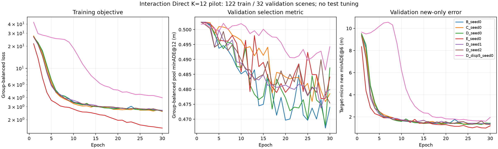

# Interaction Direct K=12: initial implementation and pilot report

## Completed scope

- New independent architecture, cache extractor, grouped trainer, evaluator and ablations implemented.
- Old Recorded K=12 source/checkpoint hashes preserved. No PDM integration modified.
- Real pilot: 122 training / 32 held-out validation groups; 6 timestamp exclusions. Test data not evaluated.
- Seven runs completed 30 epochs / 930 optimizer steps each on two GPUs. Full model includes seeds 0/1/2.
- Model selection: validation group-balanced 8s pool minADE, not the micro values below.

## Held-out validation, 10 Hz, target-micro

841 targets have valid ADE supervision; 416 have a valid 8s endpoint. All methods share the same targets/masks.

| Model | Selected epoch | Pool minADE@12 | Pool minFDE@12 | New-only minADE@6 | New-only minFDE@6 | New ADE win rate |
|---|---:|---:|---:|---:|---:|---:|
| Frozen NDPNet (K=6) | — | 0.3501 | 1.2824 | — | — | — |
| B_seed0 | 29 | 0.3213 | 0.8744 | 1.3918 | 4.6397 | 7.13% |
| C_seed0 | 29 | 0.3290 | 0.8937 | 1.3707 | 4.5878 | 6.42% |
| D_seed0 | 29 | 0.3235 | 0.8722 | 1.4493 | 4.7243 | 7.37% |
| E_seed0 | 28 | 0.3300 | 0.9257 | 1.0090 | 2.8271 | 5.11% |
| D_seed1 | 28 | 0.3250 | 0.8655 | 1.3890 | 4.5527 | 7.37% |
| D_seed2 | 30 | 0.3266 | 0.9206 | 1.3092 | 4.3400 | 8.20% |
| D_disp5_seed0 | 29 | 0.3361 | 0.9728 | 1.6005 | 5.4254 | 4.76% |

B=history-only; C=plan without post-conditioning interaction; D=full; E=D without displacement. Each group-balanced selection value and 3/5/8s class/micro/macro metrics are in `results/interaction_k12/pilot_summary.json`.

## Review

1. The implementation learns: two-scene training-only overfit reduced new-only ADE 44.109→0.462m and FDE 109.465→0.949m over 1,000 steps. This is not held-out evidence.
2. Full D adds coverage over Frozen6, but history-only B has comparable or slightly better ADE. This pilot does not establish an ego-conditioning advantage. Larger K itself cannot increase oracle error when native trajectories remain in the pool.
3. New-only predictions are substantially worse than Frozen6; pool gains come from a small fraction of complementary cases. Full D seed-0 new ADE win rate is 7.37%.
4. Direct xy decoding has a serious motion-quality limitation in this small pilot: about 89.95% of sampled new-proposal acceleration points exceed the diagnostic 15m/s² threshold for D seed 0. This includes nonwinning proposals and is not a collision/safety evaluation. Increasing displacement weight to five worsens coverage and produces much more duplicate output; it is not a solution established by this pilot.
5. D without displacement has better new-only errors but worse selected pool coverage. Pool loss/new loss and selection objectives must be reviewed separately rather than assuming any auxiliary loss is uniformly beneficial.
6. On identical 2Hz knots, D seed 0 has ADE 0.35746 / FDE 0.87223 versus historical Recorded K12 0.35038 / 0.93859. These models have very different training exposure; this is an aligned diagnostic reference, not a controlled training comparison.
7. **Correction in v0.2.0:** the earlier time-warp diagnostic did not load the checkpoint weights. Its sensitivity result is withdrawn as evidence about the trained pilot. The diagnostic loader is fixed. A later recorded-plan-only gradient audit of the full-data selected checkpoints found input dependency in C/D on 64/64 validation scenes; this is not evidence of correct causal responses. Standard pilot training/validation metrics are unaffected.

## Tests and known limits

- Thirteen existing/new unit tests passed: native preservation, load parity, group/padding isolation, agent permutation, native-mode-set permutation, frame roundtrip and new-module transform consistency, finite gradients, GT exclusion, NaN/adjacent-mask handling, zero supervision, null-plan isolation, and an isolated ego with no valid map tokens.
- FP32 permutation tolerance is 1e-5 meters after the 30m output scale; the initial tighter check differed at one coordinate by 4.25e-6m.
- Real official NDPNet checkpoint audit: all modules eval, all parameters frozen, state hash unchanged before/after a new-module optimization step; target-future input mutation produces exactly zero prediction change.
- Independent evaluator reload reproduces selected validation metrics within 1e-6.
- Full InterHub training, full external WOMD evaluation, traffic-feasible paired-plan diagnostics and causal reaction evaluation are not completed.
- Only prepared-cache preprocessing is supported directly; external native graph construction remains the audited upstream pipeline. No raw data or scene IDs are committed in the result summary.

## Resources and reproducibility

| Run | Wall seconds | Peak allocated GB | Trainable parameters |
|---|---:|---:|---:|
| B_seed0 | 76.0 | 0.866 | 633768 |
| C_seed0 | 73.5 | 1.045 | 633768 |
| D_seed0 | 79.7 | 1.161 | 633768 |
| E_seed0 | 77.0 | 1.161 | 633768 |
| D_seed1 | 78.5 | 1.161 | 633768 |
| D_seed2 | 77.4 | 1.159 | 633768 |
| D_disp5_seed0 | 74.6 | 1.161 | 633768 |

Peak memory is the high-water mark recorded at the selected validation epoch; checkpoints also retain config, normalization, git commit and actual working-tree source hashes. All models used hidden=128, batch=4 groups and one optimizer. Registered parameter counts include ablation-disabled modules; those receive no gradients when disabled. No full-data training or further architecture change was launched after this pilot. See INTERACTION_K12.md for copyable commands.

